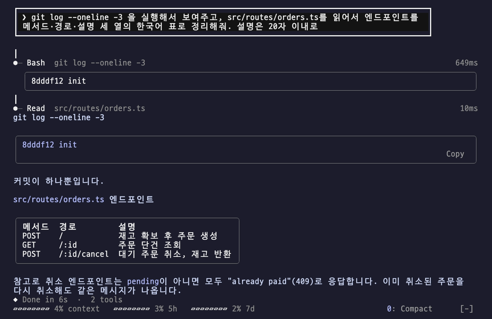

# skins

> 도구 호출·표·코드·셸 출력·Mermaid를 테마 카드로 그리고, 헤딩·경고문·체크리스트도 스킨 모양으로 보여줘요. 테마 15종을 /skin으로 바로 바꿔요



| | |
| --- | --- |
| 설치 이름 | `skins` |
| 종류 | 원본 (검토한 커밋 고정) |
| 만든 사람 | [hellosverre](https://github.com/hellosverre) |
| 라이선스 | MIT |
| 원본 | [hellosverre/claude-skins @ `985ad63`](https://github.com/hellosverre/claude-skins/tree/985ad63fdb3483bbb98f61cf57955cac3f56a449) |
| 유형 | 🎨 테마 |
| 보이는 곳 | 터미널 · 데스크톱 앱 |
| 명령어 | `/skin` |
| 권한 | 🌐 네트워크 · ⚙️ 프로그램 실행 · 🛡️ 도구 호출 제어 · 👀 대화 읽기 · 🔑 환경·설정 읽기 · 📂 파일 읽기 |

## 설치

Claude Code 안에서:

```
/plugin marketplace add SeongGwangJu/k-mods
/plugin install skins@k-mods
```

터미널에서:

```sh
claude plugin marketplace add SeongGwangJu/k-mods
claude plugin install skins@k-mods
```

이미 열려 있는 세션에는 `/reload-plugins`로 바로 적용돼요. Claude Code 2.1.287 이상이 필요해요.

## 알아 둘 점

- 도구 호출 줄은 접혀 있어요. `▸`를 누르면 입력과 결과(셸 출력 포함)가 펼쳐지고, 실패한 호출은 저절로 펼쳐져요.
- Mermaid를 그릴 수 있다는 짧은 안내(약 130토큰)를 Claude에게 넣어요. `claude -p`에는 넣지 않아요. 끄려면 `/skin hints off`예요(그리기는 그대로예요).
- 원본의 새 버전 알림은 원본 마켓플레이스(`skins@hellosverre-mods`) 기준이에요. k-mods로 설치했다면 k-mods가 검토한 뒤 올리는 `skins@k-mods` 업데이트를 기다려 주세요.
- Mermaid에서 상자 id를 한글로 쓰면 그 그림은 코드로 보여요. `A[요청] --> B[처리]`처럼 id는 영문, 라벨만 한글로 쓰면 그려져요(원본 문제).

## 이 mod가 내 컴퓨터에서 하는 일

- 🌐 **네트워크**. 코드에 있는 주소: `http://www.w3.org/2000/svg`, `https://raw.githubusercontent.com/hellosverre/claude-skins/main/.claude-plugin/plugin.json`
- ⚙️ **프로그램 실행**.
- 🛡️ **도구 호출 제어**.
- 👀 **대화 읽기**.
- 🔑 **환경·설정 읽기**.
- 📂 **파일 읽기**.

<details><summary>정적 분석 결과 (<code>claude plugin validate</code>)</summary>

- 검사한 Claude Code: 2.1.310
- 결과: 통과
- 다루는 이벤트: `classic.SessionStart{source=clear|resume|fork}`, `command.run{command=skin}`, `config.set`, `engine.create`, `prompt.compose`, `session.append`, `session.measure`, `session.start`, `skins.markdown`, `tool.call`, `tool.call{tool=/"^mcp__skins__design$"/}`, `turn.complete`, `turn.start`, `ui.invalidate`, `ui.render{component=AbovePrompt}`, `ui.render{component=AskUserQuestion}`, `ui.render{component=AssistantMessage}`, `ui.render{component=CommandOutput}`, `ui.render{component=Pane, requestId=skins-gallery}`, `ui.render{component=Pane, requestId=skins-settings}`, `ui.render{component=Spinner}`, `ui.render{component=ToolGroup}`, `ui.render{component=ToolResult}`, `ui.render{component=ToolUse}`, `ui.render{component=TurnDuration}`, `ui.render{component=UserMessage}`
- 부르는 API: `$.clock.after`, `$.clock.every`, `$.clock.now`, `$.clock.sleep`, `$.command.register`, `$.command.run`, `$.config.list`, `$.env.get`, `$.fs.read`, `$.http.fetch`, `$.process.run`, `$.session.cwd`, `$.session.id`, `$.session.usage`, `$.skinCode.draws`, `$.state.get`, `$.state.set`, `$.store.get`, `$.store.set`, `$.tool.register`, `$.ui.copy`, `$.ui.log`, `$.ui.open`, `$.ui.resolve`, `$.ui.toast`
- 읽는 환경 변수: `CI`, `COLORFGBG`, `FORCE_HYPERLINK`, `KONSOLE_VERSION`, `SKINS_THEME`, `TERM`, `TERM_PROGRAM`, `TERM_PROGRAM_VERSION`, `TMUX`, `VTE_VERSION`, `WT_SESSION`

</details>

## 검토 기록

- 2026-10-26 · k-mods · Claude Code 2.1.310 · 정적 검사, 코드 읽기, 테스트, 실제 세션 확인
- 이 항목은 위 커밋에 고정돼 있어요. 원본이 바뀌면 다시 검토한 뒤에 올려요.

<details><summary>검토 노트 9개 (코드를 읽으며 확인한 것)</summary>

- validate 통과, 원본 테스트 253개 통과(2.1.310). 원본 CI가 Linux·Windows·macOS에서 테스트·validate·타입 검사를 돌려요.
- 네트워크: 하루 한 번 원본 저장소의 plugin.json을 raw.githubusercontent.com에서 GET으로 받아 새 버전을 확인해요. 보내는 데이터 없음.
- 외부 프로세스: 테마가 auto일 때 OS의 밝기 모드를 읽으려고 macOS `defaults read -g AppleInterfaceStyle`, GNOME `gsettings get`만 실행해요.
- 파일: 자기 plugin.json만 읽고, 설정은 mod 저장소($.store)에만 써요. 모델 호출 없음.
- 명령 실행: 사용량 막대의 Compact 버튼을 눌렀을 때만 Claude Code의 /compact를 실행해요(`/skin compact off`로 버튼을 숨겨요).
- 설치 3일 뒤 GitHub 별을 부탁하는 알림을 한 번 띄워요. 화면 알림뿐이고 네트워크 요청은 없어요.
- skin-code mod가 설치돼 있으면 코드 블록이 있는 답을 그쪽에 넘겨요. 없으면 아무것도 하지 않아요.
- 차단형 훅 tool.call은 셸 명령·소요 시간을 기록하고 next(e) 결과를 그대로 돌려주며, 자기 디자인 도구(mcp__skins__design) 호출만 직접 처리해요. 다른 도구를 막지 않아요.
- Mermaid 안내문(약 130토큰)을 prompt.compose로 더해요. `claude -p` 같은 화면 없는 실행에는 넣지 않아요.

</details>

## 더 보기

- [원본 저장소](https://github.com/hellosverre/claude-skins/tree/985ad63fdb3483bbb98f61cf57955cac3f56a449)
- [카탈로그로 돌아가기](../../README.md#mod-목록)
